# 📡 MuleRadar

> **AI/ML-powered suspicious money mule account detection and investigation platform**
>
> **Bank of India Hackathon 2026 · Team Orange · Pune Institute of Computer Technology**

MuleRadar is an explainable fraud-operations platform designed to identify suspicious mule accounts from banking data, assign an interpretable risk score, surface model evidence, and support human investigation.

The system combines a **React + Vite operations console**, a **FastAPI inference/API layer**, and a dedicated **ML pipeline** containing feature engineering, feature selection, ensemble classification, anomaly detection, SHAP-based explanations, and transaction-network intelligence.

---

## 🧭 What MuleRadar Does

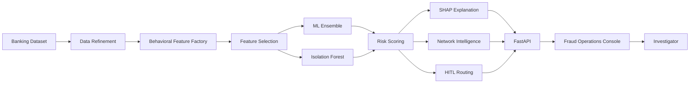

### Core workflow

**Account ID → Dataset → Feature preparation → ML ensemble → Risk probability → Risk score → Explanation → Investigation UI**

For example, the backend can evaluate an account such as `14` and return:

- Account metadata
- Model probability
- Risk score
- Risk level
- XGBoost / LightGBM / CatBoost component scores
- Isolation Forest anomaly signal
- Top SHAP contributors
- Network connections
- Human-review routing information

---

# ✨ Key Features

## 1. 🧬 Behavioral Feature Engineering

MuleRadar converts raw banking attributes into behavior-oriented signals intended to capture patterns associated with mule-account activity.

Examples include:

- **Pass-through behavior** — money entering an account and subsequently being moved out.
- **Cash-out behavior** — unusual or concentrated cash withdrawals.
- **Inward concentration** — concentration of incoming funds.
- **Counterparty/network behavior** — unusual interaction patterns.
- **Missingness signals** — preserving the fact that an activity/field is missing instead of blindly treating missingness as meaningless.

These features help transform thousands of raw banking variables into signals that are more useful for fraud detection.

---

## 2. 🎯 Multi-stage Feature Selection

The ML pipeline operates on a high-dimensional banking dataset and progressively reduces the feature space.

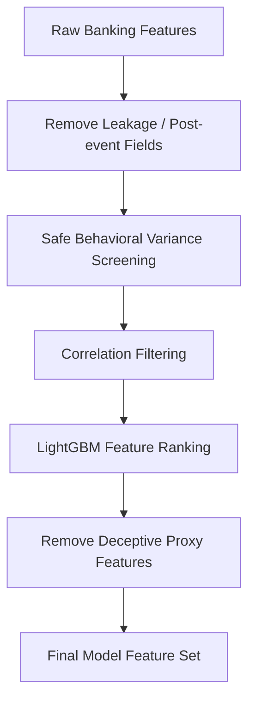

The training pipeline explicitly removes post-investigation information and avoids using `account_id` as an ML feature.

This is important because fraud models can otherwise learn **what happened after an investigation**, rather than learning the behavioral characteristics that existed before the decision.

---

# 🤖 Detection Engine

MuleRadar uses a hybrid supervised + unsupervised architecture.

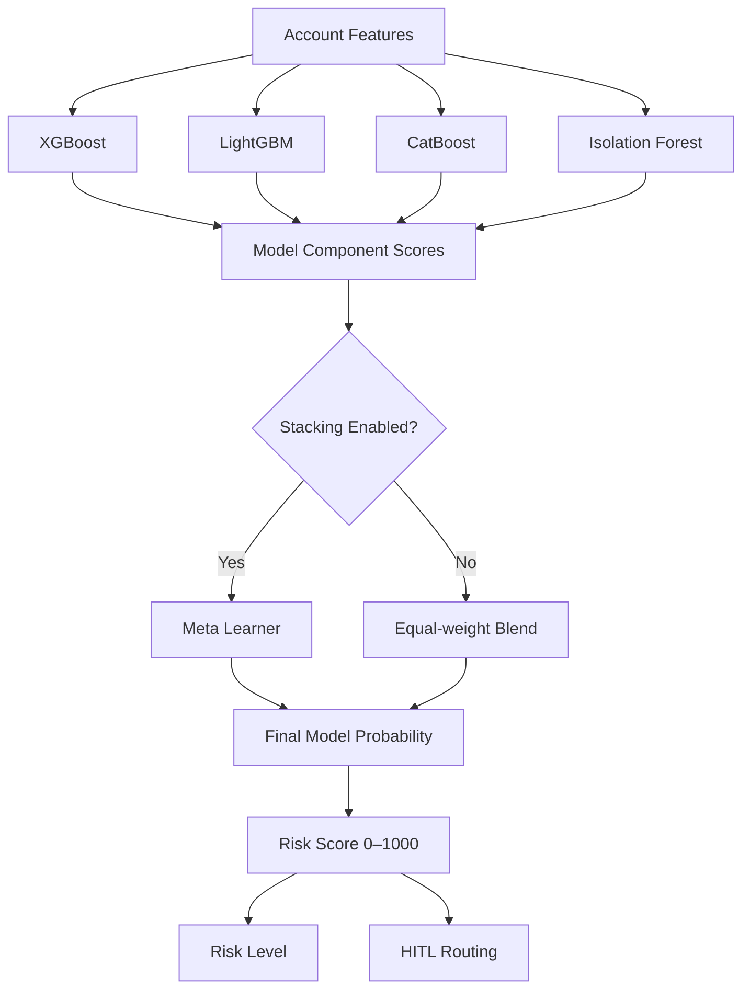

### Supervised models

- **XGBoost**
- **LightGBM**
- **CatBoost**

### Unsupervised signal

- **Isolation Forest**

### Ensemble

The system can combine the base-model probabilities and anomaly signal through a **stacked meta-learner**.

The resulting probability is converted into an investigator-friendly **0–1000 risk score**.

---

# 🚦 Risk Scoring

MuleRadar maps the model probability into four operational risk levels:

| Risk Score | Risk Level | Operational Meaning |
|---:|---|---|
| **0–449** | 🟢 Low | Low-risk / auto-clear range |
| **450–749** | 🟡 Medium | Human review recommended |
| **750–899** | 🟠 High | High-risk account |
| **900–1000** | 🔴 Critical | Highest-risk accounts / auto-block band |

The exact score is produced by the calibrated scoring logic in the backend rather than being a simple display-only probability.

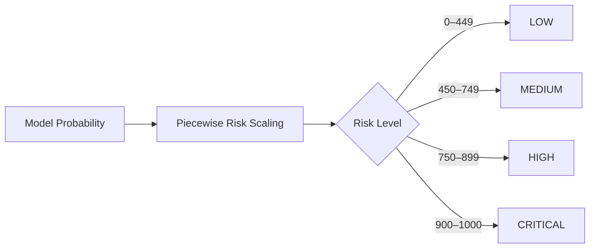

---

# 🔎 Explainable AI

A prediction should not simply say:

> **"This account is risky."**

MuleRadar also attempts to answer:

> **"Why does the model consider this account risky?"**

The backend uses **SHAP** to identify the most influential model features for an individual account.

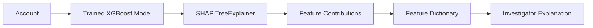

The API can return the strongest feature contributions together with their feature codes, display names, and descriptions when available.

Examples of investigator-facing behavioral explanations can include concepts such as:

- High transaction activity
- Unusual cash-out behavior
- Strong pass-through behavior
- Concentrated incoming funds
- Narrow counterparty activity

> **Note:** The exact explanation shown depends on the features present in the account and the feature dictionary mappings available in the current model/data version.

---

# 🕸️ Network Intelligence

MuleRadar also exposes account-level transaction/network context.

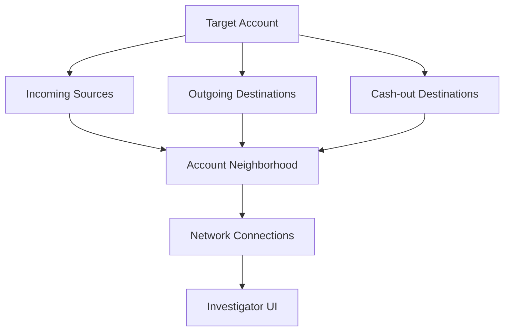

This allows investigators to see an account together with related source/destination nodes and transaction amounts.

The current implementation includes a graph-initialization layer for account-neighborhood intelligence.

---

# 👩‍💻 Human-in-the-Loop Investigation

MuleRadar is designed to support investigators rather than blindly automate every decision.

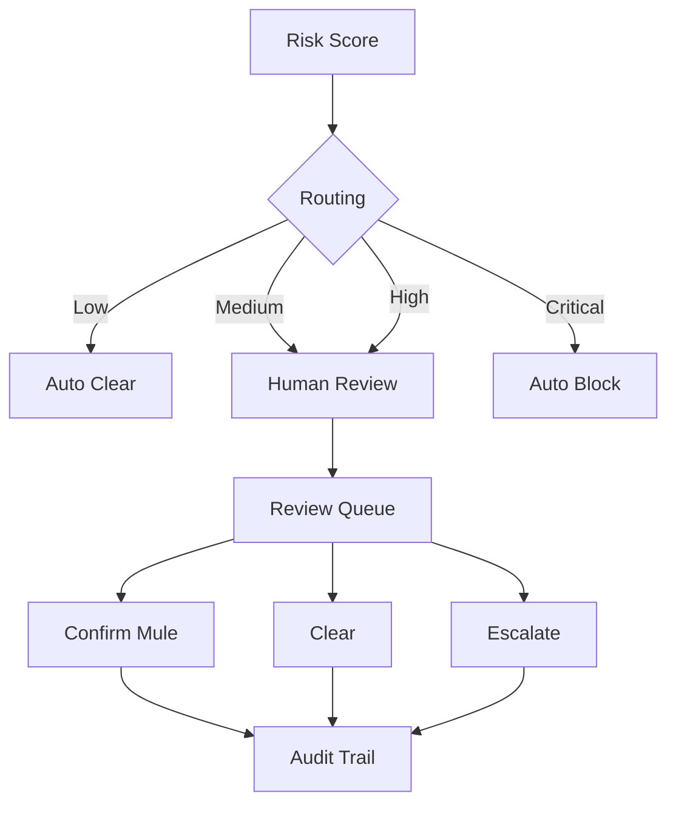

The backend exposes a review queue and audit-trail functionality so that investigator decisions can be recorded.

---

# 🏗️ System Architecture

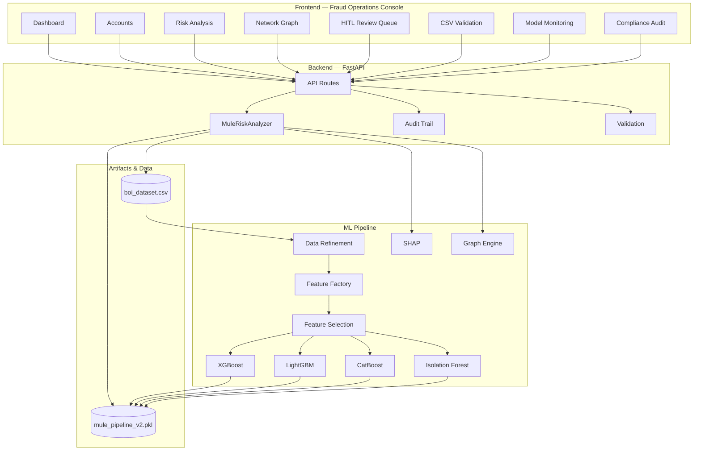

---

# 📂 Project Structure

```text
BOI/
│
├── README.md
├── Bank of India (BOI) Hackathon 2026.md
├── Description.xlsx
│
└── muleradar/
    │
    ├── frontend/
    │   ├── public/
    │   ├── src/
    │   ├── package.json
    │   └── ...
    │
    ├── backend/
    │   ├── app/
    │   │   ├── api/
    │   │   ├── schemas/
    │   │   └── services/
    │   ├── requirements.txt
    │   └── ...
    │
    ├── ml_pipeline/
    │   ├── data/
    │   │   └── boi_dataset.csv
    │   ├── notebooks/
    │   ├── saved_models/
    │   │   └── mule_pipeline_v2.pkl
    │   └── src/
    │       ├── data_refinement/
    │       ├── explainability/
    │       ├── feature_factory/
    │       ├── graph_engine/
    │       └── models/
    │
    └── docs/
        └── ...
```

---

# 🧰 Technology Stack

| Layer | Technologies |
|---|---|
| **Frontend** | React 18, TypeScript, Vite, Tailwind CSS |
| **Visualization** | D3.js |
| **API** | FastAPI, Uvicorn |
| **ML** | XGBoost, LightGBM, CatBoost, Scikit-learn |
| **Anomaly Detection** | Isolation Forest |
| **Explainability** | SHAP |
| **Data Processing** | Pandas, NumPy |
| **Model Persistence** | Joblib / `.pkl` artifact |
| **Graph Intelligence** | Python graph-engine layer |
| **Frontend API Client** | Axios |

---

# 🚀 Local Setup

## Prerequisites

Recommended environment:

- Python **3.11**
- Node.js / npm
- Git

---

## 1. Clone the repository

```bash
git clone https://github.com/gargijoshi9/BOI.git
cd BOI/muleradar
```

---

# 🐍 2. Backend Setup

From the project root:

```powershell
cd backend
py -3.11 -m venv venv
.\venv\Scripts\Activate.ps1
python -m pip install --upgrade pip
python -m pip install -r requirements.txt
```

Then return to the project root:

```powershell
cd ..
```

Start the backend from the **project root**:

```powershell
python -m uvicorn backend.app.main:app --reload
```

Backend:

```text
http://127.0.0.1:8000
```

Swagger documentation:

```text
http://127.0.0.1:8000/docs
```

Health check:

```text
http://127.0.0.1:8000/health
```

---

# ⚛️ 3. Frontend Setup

Open a **second terminal**.

From the project root:

```powershell
cd muleradar\frontend
npm install
npm run dev
```

Vite will provide the frontend development URL, normally:

```text
http://localhost:5173
```

The frontend communicates with the FastAPI backend running on port `8000`.

---

# 🔄 Running Both Together

You should have two terminals:

### Terminal 1 — Backend

```powershell
cd D:\Hackathons\BOI\muleradar
.\backend\venv\Scripts\Activate.ps1
python -m uvicorn backend.app.main:app --reload
```

### Terminal 2 — Frontend

```powershell
cd D:\Hackathons\BOI\muleradar\frontend
npm run dev
```

Architecture during development:

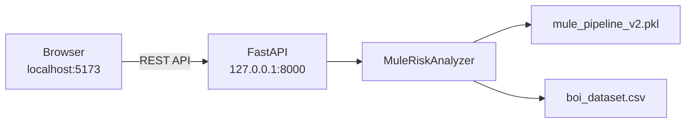

---

# 📡 API Endpoints

The current backend exposes account evaluation, account listing, validation, review-queue, and audit-trail functionality.

| Method | Endpoint | Purpose |
|---|---|---|
| `GET` | `/health` | Backend + ML engine health |
| `GET` | `/api/v1/accounts` | Retrieve account evaluations |
| `GET` | `/api/v1/evaluate/{account_id}` | Evaluate one account |
| `POST` | `/api/v1/evaluate/{account_id}` | Evaluate one account |
| `POST` | `/api/v1/validate` | Validate/infer on an uploaded CSV |
| `GET` | `/api/v1/review-queue` | Retrieve HITL review queue |
| `POST` | `/api/v1/review-queue/{account_id}/resolve` | Record investigator decision |
| `GET` | `/api/v1/review-queue/audit-trail` | Retrieve audit history |

---

# 🧪 Example Account Evaluation

Request:

```http
GET /api/v1/evaluate/14
```

Conceptual response:

```json
{
  "account_id": "14",
  "account_type": "Savings",
  "occupation": "agriculture",
  "age": 35,
  "model_probability": 0.3558,
  "risk_score": 274,
  "risk_level": "Low",
  "shap_explanation": [
    {
      "feature": "F1596",
      "contribution": -1.109
    }
  ],
  "human_review": {
    "requires_review": false,
    "confidence_band": "AUTO_CLEAR"
  }
}
```

The exact values depend on the current dataset and trained model artifact.

---

# 🧠 Model Training Pipeline

Training is implemented in:

```text
ml_pipeline/src/models/train.py
```

The training workflow includes:

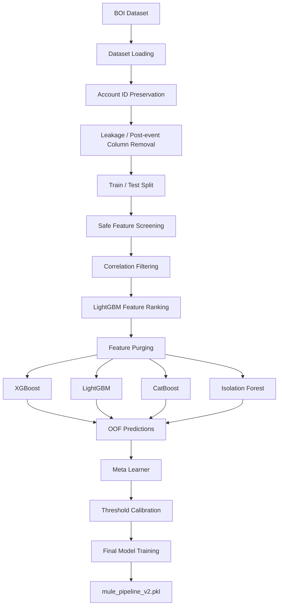

The training script also contains:

- Stratified splitting
- Class-imbalance handling
- Hyperparameter tuning with Optuna
- Out-of-fold predictions
- Meta-model selection
- F2-based threshold calibration
- Hold-out evaluation
- Model artifact serialization

---

# 🔐 Data Leakage Prevention

Fraud detection datasets can contain fields that are only known **after** an investigation or account action.

Using those fields during training can create artificially strong performance while failing in real-world deployment.

MuleRadar therefore explicitly:

- Removes post-investigation outcome columns.
- Removes suspicious timestamp/proxy information.
- Preserves `account_id` for dataset/UI identity but excludes it from model features.
- Uses a strict train/test separation.
- Performs feature selection using separate data partitions.

This makes the model pipeline more representative of a real deployment scenario.

---

# 📊 Model Evaluation

The training pipeline evaluates the final model using fraud-detection-oriented metrics including:

- **PR-AUC**
- **ROC-AUC**
- **Precision**
- **Recall**
- **F2-score / operating threshold**
- **Confusion matrix**
- Classification report

For highly imbalanced fraud datasets, PR-AUC and recall/precision trade-offs are especially important because accuracy alone can be misleading.

---

# 🛡️ Investigator Workflow

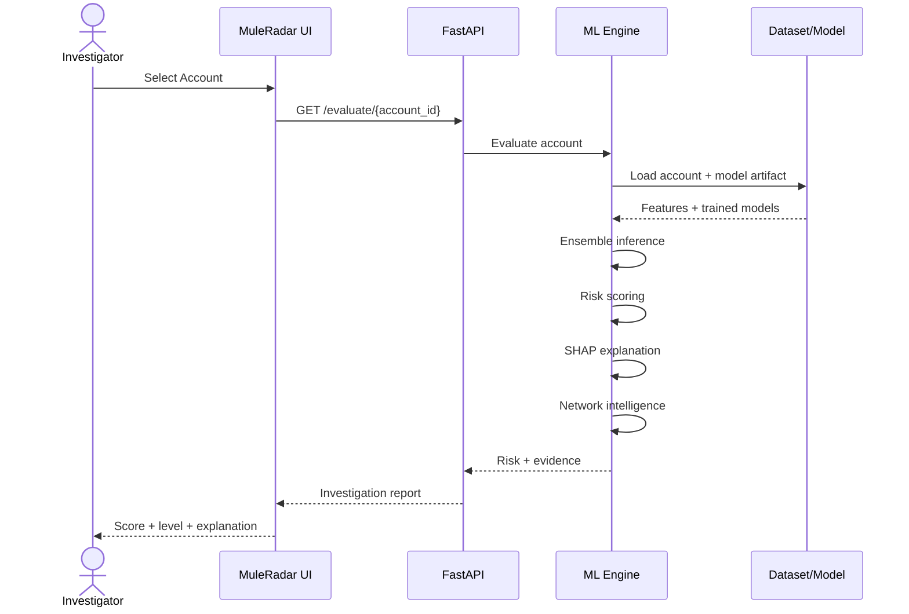

---

# 🧩 Example Investigation Report

An investigator should be able to move from:

```text
ACCOUNT
   ↓
Risk Score
   ↓
Risk Level
   ↓
Why?
   ├── Behavioral evidence
   ├── SHAP contributors
   ├── Model component scores
   └── Network connections
   ↓
Human Review Decision
   ↓
Audit Trail
```

This turns the ML model from a black-box classifier into an **investigation-support system**.

---

# ⚠️ Important Notes

### Model artifact

The backend expects the trained model artifact at:

```text
muleradar/ml_pipeline/saved_models/mule_pipeline_v2.pkl
```

If the artifact is missing, the backend reports that the trained model artifact is unavailable and cannot perform the same real-model account evaluation.

### Dataset

The backend expects:

```text
muleradar/ml_pipeline/data/boi_dataset.csv
```

The dataset must contain the account identity information expected by the current pipeline. The training and backend code can normalize an `Unnamed: 0` column into `account_id` when necessary.

### Secrets

Do **not** commit API keys, credentials, `.env` secrets, or other sensitive configuration to GitHub.

---

# 🧪 Development Checklist

Before a demo:

```text
[ ] Python 3.11 environment active
[ ] Backend dependencies installed
[ ] Frontend dependencies installed
[ ] boi_dataset.csv available
[ ] mule_pipeline_v2.pkl available
[ ] Backend starts successfully
[ ] /health returns online
[ ] /docs opens successfully
[ ] /api/v1/accounts returns accounts
[ ] Known account evaluation works
[ ] Frontend can reach backend
[ ] SHAP explanations are displayed
[ ] Review queue works
[ ] Audit trail works
```

---

# 🏆 Hackathon

**Bank of India Hackathon 2026**

MuleRadar is developed as an AI/ML-driven solution for suspicious money mule account detection, risk assessment, explainability, and investigator-assisted fraud operations.

---

## 📜 License

Add the project's chosen license here before public release.

---

<div align="center">

### 📡 MuleRadar

**Detect suspicious behavior. Explain the risk. Assist the investigator.**

Built with ❤️ by **Team Orange · PICT**

</div>
